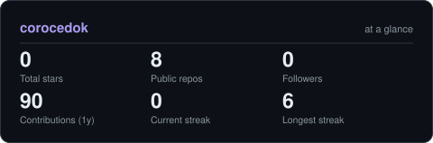

<!-- BANNER: terminal profile.sh --live. Se genera con scripts/banner/generate.py -->
<picture>
  <source media="(prefers-color-scheme: dark)"  srcset="assets/banner-dark.v1.svg">
  <source media="(prefers-color-scheme: light)" srcset="assets/banner-light.v1.svg">
  
</picture>

 

 

<!-- REDES: cambia TU-USUARIO por tus usuarios reales o borra la línea que no uses -->
&nbsp;&nbsp;
&nbsp;&nbsp;

 

---

## Este soy yo :)

Hola, soy **Camila** 🦇, estudiante de Ingeniería en Informática en Duoc UC.
Me gusta aprender construyendo cosas que funcionen y que se vean bien.

- 💻 **Programación:** he trabajado con Python, Java, Kotlin, HTML y CSS.
- 📱 **Mi primera app:** una aplicación Android básica hecha con Kotlin y Android Studio.
- 🔐 **Ciberseguridad:** armé un laboratorio con Kali Linux en VirtualBox para practicar sin riesgos.
- ☁️ **Nube:** di mis primeros pasos con AWS Academy.
- 🌐 **Web:** mi portafolio está hecho con React y Bootstrap, con pruebas unitarias en Karma.

 

---

## signals

<table>
<tr>
<td width="50%" align="center" valign="middle">

<!-- Radar de habilidades: edita assets/skills.json y el workflow lo redibuja -->
<picture>
  <source media="(prefers-color-scheme: dark)"  srcset="assets/radar-dark.svg">
  <source media="(prefers-color-scheme: light)" srcset="assets/radar-light.svg">
  
</picture>

</td>
<td width="50%" align="center" valign="middle">

<!-- Radar de lenguajes: edita assets/langmix.json -->
<picture>
  <source media="(prefers-color-scheme: dark)"  srcset="assets/radar-langs-dark.svg">
  <source media="(prefers-color-scheme: light)" srcset="assets/radar-langs-light.svg">
  
</picture>

</td>
</tr>
</table>

---

## números

<!-- Lo genera el workflow "Charts and cards" (scripts/cards.py) -->
<picture>
  <source media="(prefers-color-scheme: dark)"  srcset="assets/card-stats-dark.svg">
  <source media="(prefers-color-scheme: light)" srcset="assets/card-stats-light.svg">
  
</picture>

---

`hecho con cariño · COROCEDOK`

